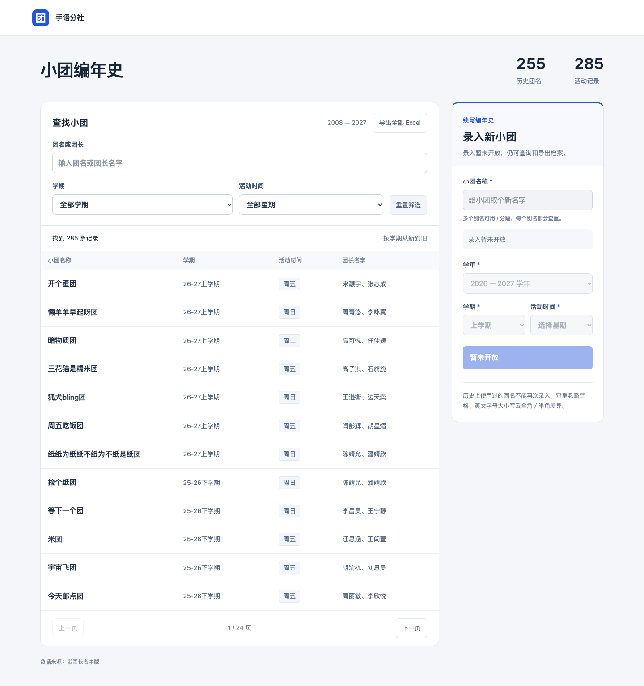

# 小团编年史

手语分社的小团档案查询网页，使用 Python 标准库、HTML/CSS/JavaScript 和 SQLite。



## 当前功能

- 285条活动记录、255个团名，包含团长名字。
- 按团名或团长搜索，组合筛选学期和活动星期，按学期从新到旧分页展示。
- 一键导出全部 Excel，包含小团名称、学期、活动时间和团长名字。
- 新团录入界面保留，输入及提交暂时关闭，后台拒绝新增请求。
- 网页不显示新增记录的黄色提示；参考 Excel 保留原有标记。
- “好戏团”已更名为“老赖这不走看芳蛙后援团好戏团”。

## 本地启动

需要 Python 3.9 或更新版本，无需安装后端依赖：

```bash
python3 server.py
```

打开 http://127.0.0.1:8765/ 。macOS 可双击 `启动网页.command`，使用期间保留启动窗口。

```bash
python3 server.py --port 8765 --database /path/to/archive.sqlite3
```

## 数据与资料

- `references/带团长名字版.xlsx`：当前网页依据的表格。
- `references/`：原始 Excel、更新表格和设计反馈截图。
- `data/initial.json`：当前285条档案及团长信息。
- `data/archive.sqlite3`：当前数据库快照。
- `data/archive.before-leaders.sqlite3`：补充团长前的数据库备份。
- `dist/`：网页界面与交互；`server.py`：查询、保存及导出接口。
- `docs/`：页面预览、设计记录和部署说明。

学期与星期沿用表格，历史重复记录保留。网页团名不含 Excel 的“【新增】”标记。服务启动时按数据版本更新导入的历史记录，并保留本地单独录入的数据。修改 Excel 不会自动更新网页，需要同步 `initial.json`。服务只监听本机127.0.0.1。

## 验证

```bash
python3 -m unittest -v test_archive.py
```

后端测试使用临时数据库，覆盖数据导入、重复检查、关闭录入、无效输入和并发保护。浏览器测试 `test_browser.cjs` 使用本地8765端口，验证搜索、团长信息、筛选、禁用表单与接口、Excel导出及手机布局；运行前需按本机环境调整 Playwright 依赖路径。录入功能当前保持关闭。

本仓库按项目所有者要求公开提供代码及相关数据。本次更新仅同步GitHub，不部署线上服务。
